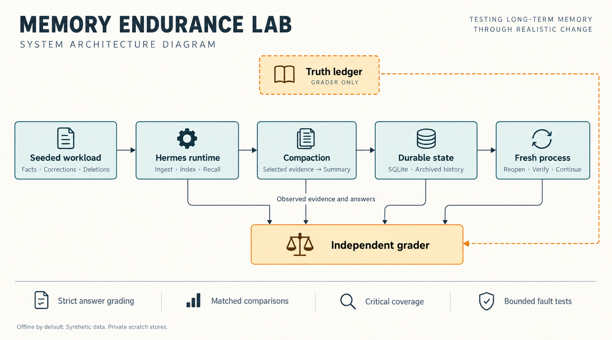
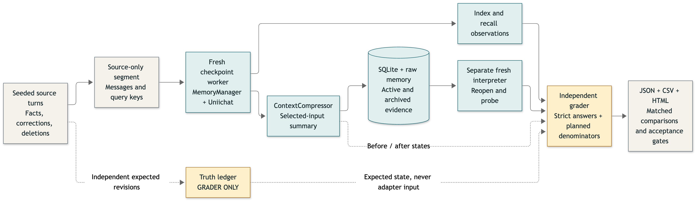
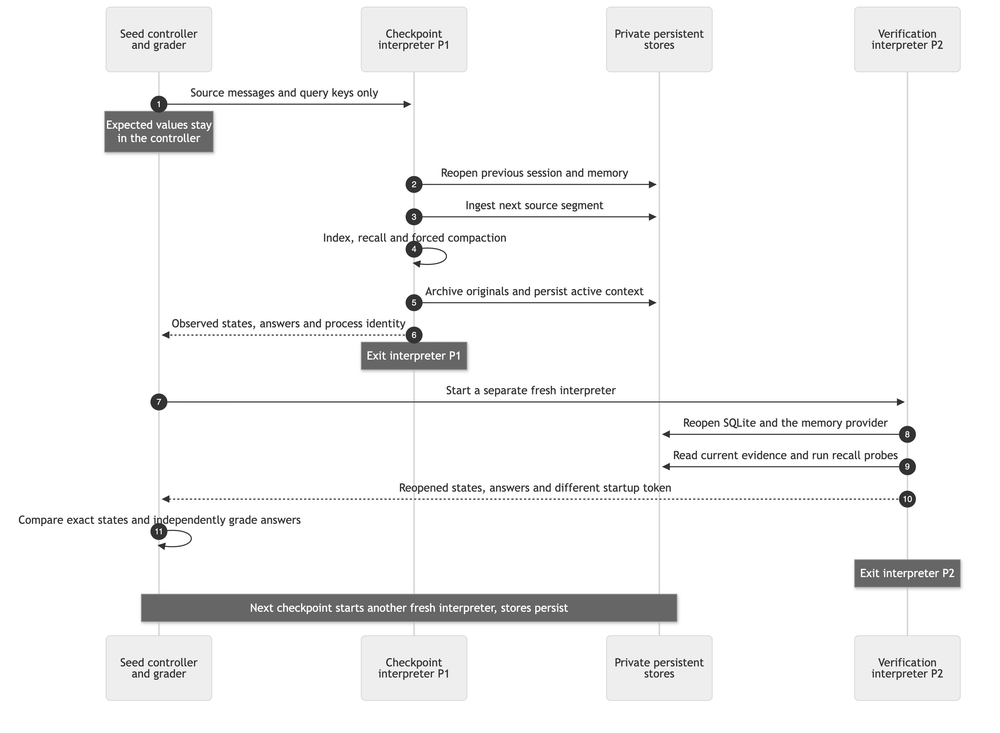
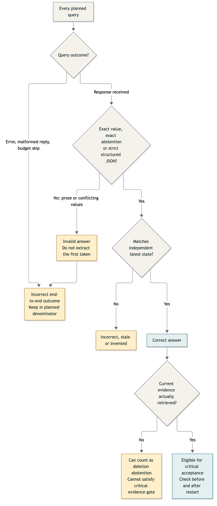

# Hermes Memory Lab

**Reproducible memory and compaction diagnostics, with strict grading and real process restarts.**



> A private engineering lab, not a production memory plugin. Default evaluations
> are offline, use fictional data, and leave live profiles and installed source
> untouched. Scripted scores measure infrastructure behavior, not semantic model accuracy.

**[Quick start](#quick-start) · [Diagrams](#diagrams) · [Grading](#grading-contract) ·
[Results](docs/results.md) · [Changes](CHANGELOG.md)**

## What it tests

| Area | Contract |
|---|---|
| Ingestion | Current facts and tool-only evidence reach persistent memory. |
| Indexing | New records become searchable without stale caches. |
| Recall | Return the current value, abstain correctly, and retrieve supporting evidence. |
| Compaction | Preserve observed evidence selected for summarization. |
| Restarts | Fresh interpreters reopen SQLite and memory without changing observed fact states. |
| Faults | Test concurrent writers, interrupted index writes, malformed records, profile leakage and summary failures. |

The tested components are real: `MemoryManager`, the Uniichat provider and tool,
`ContextCompressor`, and `SessionDB`. The router, answerer and summarizer are
deterministic source-only substitutes in offline mode.

The grader owns expected revisions. Workers receive only source messages and
query keys, never an expected-answer table.

## Quick start

### Prerequisites

- Python **3.10+**.
- An installed Hermes core and Uniichat plugin, with compatible Hermes test dependencies.
- macOS or Linux for process-group cancellation and descendant cleanup.
- Node **22+** and Chrome only if regenerating diagram images.

The launcher discovers a local `.venv`, a Hermes `.venv`, or a managed Hermes test
interpreter. For reproducibility, select one explicitly:

```sh
export MEMORY_SIM_PYTHON=/absolute/path/to/hermes-test-venv/bin/python
```

Default target discovery uses the current user's installed Hermes locations.
Override nonstandard installations with CLI flags or `MEMORY_SIM_CORE_ROOT` and
`MEMORY_SIM_PLUGIN`. The lab never installs or updates Hermes dependencies.

```sh
# Harness tests, including installed-target integration where available.
./run-simulator.sh test

# Five seeds, 100 facts, 200 turns, three compactions per seed.
./run-simulator.sh run --preset smoke

# 500 facts, 5,000 turns, 30 compactions, 60 fresh component interpreters.
./run-simulator.sh run --preset endurance --seeds 1 --timeout 300

# Actual writer processes, an actual index-write crash, and behavior contracts.
./run-simulator.sh run --preset chaos --seeds 1 --workers 8
```

Existing output directories are rejected. Default reports go to a fresh
timestamped directory under `runs/`, which is excluded from Git.

Without installed targets, dependency-free tests still run; integration tests
are explicitly skipped. Those skips are not proof of runtime compatibility.

## Diagrams

The overview above was generated as an image. The diagrams below are reproducible
Mermaid graphs, checked in as **`.mmd` source, SVG and PNG**.

### Evidence flow



[Mermaid source](docs/diagrams/evidence-flow.mmd) · [Vector image](docs/images/evidence-flow.svg)

### Fresh-process lifecycle



[Mermaid source](docs/diagrams/restart-lifecycle.mmd) · [Vector image](docs/images/restart-lifecycle.svg)

<details>
<summary><strong>Strict grading decision graph</strong></summary>



[Mermaid source](docs/diagrams/grading-contract.mmd) · [Vector image](docs/images/grading-contract.svg)

</details>

To regenerate all six graph images:

```sh
# Use an existing Chrome installation instead of downloading a second browser.
PUPPETEER_SKIP_DOWNLOAD=1 npm ci
npm run diagrams

# Optional nonstandard Chrome location.
CHROME_BIN=/absolute/path/to/chrome npm run diagrams
```

The renderer uses Mermaid CLI **12.0.0** and a lockfile. KaTeX **0.19.0** is
explicitly overridden to address the renderer's transitive advisory. Rendering
and the patched math API are verified; SVGs do not embed system font files.

## Grading contract

### Strict answers

Accepted response text is an exact synthetic value, an exact abstention, or
strict structured JSON:

```text
v-0123456789
NOT FOUND
```

```json
{"status":"found","value":"v-0123456789"}
```

```json
{"status":"not_found","value":null}
```

Whitespace is trimmed. `NOT_FOUND` and `NOT-FOUND` normalize to abstention.
Prose such as “`v-old` is obsolete; use `v-new`” is invalid, not graded using its
first matching token. Conflicting fields, duplicate keys and extra JSON keys are rejected.

### Honest denominators

**End-to-end recall = correct answers / all planned relevant queries.**

Errors, invalid answers and budget skips stay in the denominator. Conditional
answer accuracy and query completion are reported separately.

- **Active-value recall** excludes deleted and unknown facts.
- **Known-state correctness** also includes correct deletion abstentions.
- **Deletion abstention alone is not evidence retention.**
- **Critical acceptance** requires correct answers and retrieved current evidence
  both before and after restart, with no errors, omissions or skipped probes.

Critical facts are stratified across short, buried and tool-only evidence.
Approximately 10% are critical, with at least one per available evidence group.
Small workloads therefore have a higher critical fraction. Capped critical
probes rotate across groups rather than selecting only short-message facts.

## Restarts and controlled experiments

`--restart-mode process` is the default:

1. A fresh interpreter reopens the previous session and ingests the next segment.
2. It runs indexing, recall, compaction and persistence, then exits.
3. A separate fresh interpreter reopens the stores and probes memory again.
4. The controller compares exact observed states and independently grades answers.

Process IDs and startup tokens are recorded. `--restart-mode objects` is an
explicit same-interpreter control, not labeled as a process restart.

This tests **component interpreter restarts**, not a deployed gateway, full
interactive agent loop, saved prompt cache, or OS reboot.

Long-run tests prepare the tree directory and force one warm index after the
first ten turns. Unassisted cold-start behavior remains a separate chaos check.

`--index-policy rebuild` forces rebuilding at checkpoints. It is a diagnostic
control, not a production fix. Context resets at configured session boundaries
are intentional; per-compaction loss counts only evidence present immediately
before, but absent immediately after, that compaction.

## Compare versions safely

```sh
./run-simulator.sh run --preset smoke --output /absolute/path/before
./run-simulator.sh run --preset smoke \
  --plugin /absolute/path/trusted-candidate/__init__.py \
  --output /absolute/path/after

./run-simulator.sh compare \
  --left /absolute/path/before/run.json \
  --right /absolute/path/after/run.json \
  --output /absolute/path/comparison
```

Comparisons require the same seeds, generated-workload fingerprints, grading/workload
versions, harness code, settings and compatible environment metadata. Normal
comparisons require complete jobs and aligned final checkpoints.

- `--allow-confounded` explicitly permits changed settings and labels the differences.
- `--allow-incomplete` uses only a shared checkpoint, never unrelated last snapshots.
- Different source workloads or grading/harness versions cannot be bypassed.
- Plugin/core source changes are the intended treatment; index policy changes are
  separately labeled diagnostic controls.

There are no statistical confidence claims from one endurance run or five
fictional seeds. Source fingerprints cover selected core modules, not every
external dependency or backend model revision.

## Optional real inference and historical shaping

```sh
# Requires an already-exported SURPLUS_API_KEY; no credential files are searched.
./run-simulator.sh run --preset smoke --seeds 1 \
  --inference surplus --max-api-calls 12 --timeout 300

# Reads SQLite message lengths and role counts only, not private text.
./run-simulator.sh run --preset smoke --seeds 1 \
  --shape-from-profile /absolute/path/to/profile
```

Real inference uses `glm-5.3-flash`, is opt-in and smoke-only, and shares one
per-seed call budget across recall, summaries and post-restart probes. Exhaustion
is reported as a skipped failure, never success. Index side-summaries remain
deterministic. No real inference was used for the published release baseline.

Historical shaping uses read-only numeric metadata. It adjusts fictional filler
lengths; it is not a historical-session replay and does not recreate the real
role mix.

## Safety and artifacts

- Private synthetic homes, runtime directories, raw stores and SQLite databases.
- Python networking blocked except during explicitly budgeted inference.
- Per-job deadlines and owned-process-group cleanup on SIGINT/SIGTERM.
- Interrupted runs preserve reports and do not schedule remaining seeds.
- Streamed workload generation/hashing and owned-directory disk checks.
- Unique temporary files and atomic checkpoint replacement.
- No automatic dependency preparation, live-profile edits or target-source edits.

**This is not an OS security sandbox or a hard RAM/disk quota.** Run only trusted
target code. Native subprocess networking and malicious plugins are outside this
isolation model. Scratch stores are normally removed; abruptly terminated jobs
may retain synthetic scratch files.

| Exit code | Meaning |
|---|---|
| `0` | Jobs completed and reports saved; target behavior may still fail checks. |
| `1` | `--strict` was used and acceptance gates failed. |
| `2` | Invalid setup, failed/expired job, resource exhaustion or cancellation. |

Artifacts include `run.json`, `curve.csv`, standalone `report.html`, per-seed
source/truth/trace JSONL, checkpoint and restart observations, fault results, and
matched-comparison JSON/Markdown. Raw artifacts stay local and are Git-ignored.
Only safe numeric release summaries are committed.

## Repository layout

```text
simulator.py              CLI, validation, acceptance gates
memory_sim/
  workload.py             Seeded events and independent ledger
  grading.py              Strict responses and planned-query metrics
  pipeline.py             Source replay, persistence and fresh workers
  processes.py            Owned groups, deadlines and signal cleanup
  runtime.py              Isolated real target imports and source-only adapters
  regressions.py          Self-contained synthetic behavior contracts
  chaos.py                Profile, writer, crash and malformed-state faults
  report.py               Metrics, comparisons, CSV and HTML
tests/                    Unit and actual component/process integration tests
docs/diagrams/            Mermaid sources
docs/images/              Generated overview and rendered PNG/SVG graphs
tools/render_diagrams.py  Reproducible diagram renderer
tools/export_results.py   Safe release-evidence exporter
```

See [CHANGELOG.md](CHANGELOG.md) for the six-gap hardening work and
[executed results](docs/results.md) for baseline failures. The lab's tests passing
does not imply that the unchanged memory plugin passes its behavior contracts.
